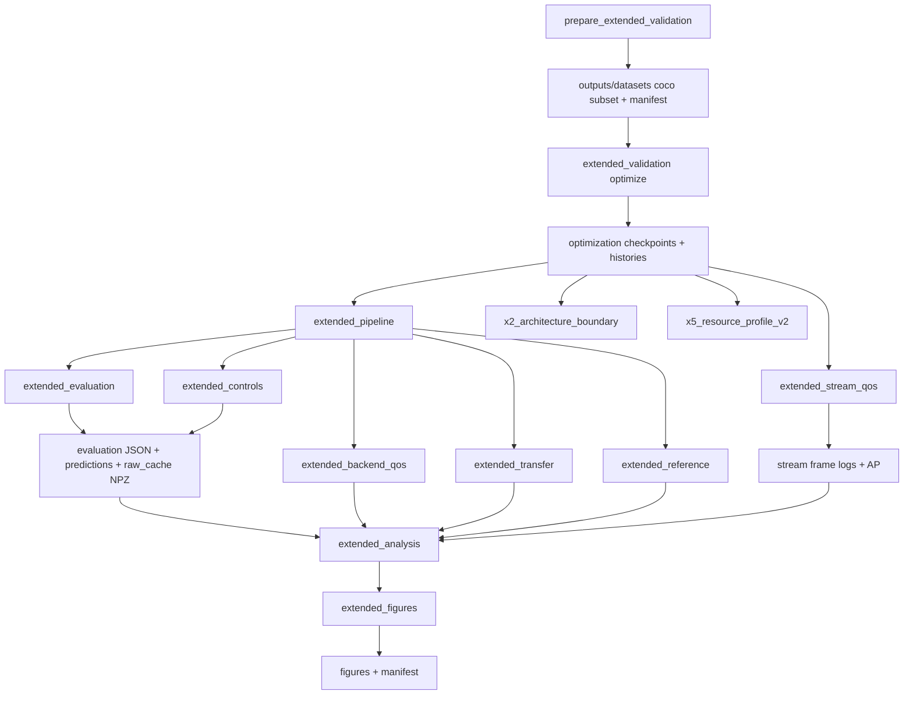

# 01 — Kiểm kê repo (21/10/2026, Asia/Saigon)

## Phạm vi và phương pháp

Áp dụng academic-research-suite ARS-Codex 3.23.0, bản adapter của https://github.com/imbad0202/academic-research-skills. Review theo 5 giai đoạn riêng của tác giả, không phải panel phản biện độc lập được hiệu chuẩn. Verification Status: ANALYZED; chưa rerun detector/training. Không suy ra người dùng đã đọc hay duyệt tài liệu.

Workspace `D:\Physical-Visual-DoS-EdgeAI-main`. Không có `AGENTS.md` tại workspace hoặc `D:/AGENTS.md`; tìm `rg --files -g AGENTS.md` không có kết quả. Repo đã dirty từ trước review; không reset/commit. Chỉ tạo 5 Markdown yêu cầu trong REVIEW, bắt đầu bằng file này. Kiểm kê trước khi tạo REVIEW: **235,037 files; 48,749,863,854 bytes (45.402 GiB)**; gồm `.git`, hidden files, datasets, vendor, environments. Không theo directory symlink. Không kiểm nội dung mọi binary; số byte là logical size, không phải allocated disk.

Errors đọc metadata: 0. Snapshot có thể đổi nếu tiến trình X1/X5 bên ngoài tiếp tục ghi; không tự dừng tiến trình của tác giả.

## 1. Cây thư mục 3 cấp và dung lượng

| Thư mục (depth ≤ 3) | Files đệ quy | Bytes | GiB |
|---|---:|---:|---:|
| `.git/` | 1,591 | 680,728,377 | 0.6340 |
| `.git/gk/` | 1 | 91 | 0.0000 |
| `.git/hooks/` | 14 | 26,788 | 0.0000 |
| `.git/info/` | 2 | 1,166 | 0.0000 |
| `.git/lfs/` | 52 | 29,347,201 | 0.0273 |
| `.git/lfs/objects/` | 52 | 29,347,201 | 0.0273 |
| `.git/logs/` | 9 | 20,850 | 0.0000 |
| `.git/logs/refs/` | 8 | 12,176 | 0.0000 |
| `.git/objects/` | 1,463 | 651,099,140 | 0.6064 |
| `.git/objects/00/` | 7 | 489,571 | 0.0005 |
| `.git/objects/01/` | 5 | 52,586 | 0.0000 |
| `.git/objects/02/` | 8 | 38,298 | 0.0000 |
| `.git/objects/03/` | 6 | 37,276 | 0.0000 |
| `.git/objects/04/` | 5 | 1,154,059 | 0.0011 |
| `.git/objects/05/` | 6 | 216,884 | 0.0002 |
| `.git/objects/06/` | 4 | 89,575 | 0.0001 |
| `.git/objects/07/` | 5 | 158,427 | 0.0001 |
| `.git/objects/08/` | 9 | 3,445,542 | 0.0032 |
| `.git/objects/09/` | 5 | 3,015 | 0.0000 |
| `.git/objects/0a/` | 7 | 470,725 | 0.0004 |
| `.git/objects/0c/` | 6 | 522,767 | 0.0005 |
| `.git/objects/0d/` | 5 | 6,099,693 | 0.0057 |
| `.git/objects/0e/` | 10 | 2,940,658 | 0.0027 |
| `.git/objects/0f/` | 8 | 25,048 | 0.0000 |
| `.git/objects/10/` | 7 | 478,540 | 0.0004 |
| `.git/objects/11/` | 5 | 148,538 | 0.0001 |
| `.git/objects/12/` | 3 | 204,793 | 0.0002 |
| `.git/objects/13/` | 8 | 351,585 | 0.0003 |
| `.git/objects/14/` | 7 | 109,466 | 0.0001 |
| `.git/objects/15/` | 11 | 130,673 | 0.0001 |
| `.git/objects/16/` | 3 | 133,273 | 0.0001 |
| `.git/objects/17/` | 2 | 3,700,598 | 0.0034 |
| `.git/objects/18/` | 5 | 1,901,227 | 0.0018 |
| `.git/objects/19/` | 7 | 535,676 | 0.0005 |
| `.git/objects/1a/` | 10 | 112,289 | 0.0001 |
| `.git/objects/1b/` | 8 | 353,233 | 0.0003 |
| `.git/objects/1c/` | 6 | 435,900 | 0.0004 |
| `.git/objects/1d/` | 3 | 88,818 | 0.0001 |
| `.git/objects/1e/` | 5 | 29,269 | 0.0000 |
| `.git/objects/1f/` | 2 | 161,845 | 0.0002 |
| `.git/objects/20/` | 4 | 29,263 | 0.0000 |
| `.git/objects/21/` | 4 | 529,865 | 0.0005 |
| `.git/objects/22/` | 1 | 9,792 | 0.0000 |
| `.git/objects/23/` | 3 | 10,586 | 0.0000 |
| `.git/objects/24/` | 3 | 4,557 | 0.0000 |
| `.git/objects/25/` | 5 | 6,974 | 0.0000 |
| `.git/objects/26/` | 3 | 16,942 | 0.0000 |
| `.git/objects/27/` | 7 | 264,348 | 0.0002 |
| `.git/objects/28/` | 7 | 4,389 | 0.0000 |
| `.git/objects/29/` | 8 | 320,052 | 0.0003 |
| `.git/objects/2a/` | 4 | 85,089 | 0.0001 |
| `.git/objects/2b/` | 2 | 2,205,564 | 0.0021 |
| `.git/objects/2c/` | 4 | 73,274 | 0.0001 |
| `.git/objects/2d/` | 7 | 39,268 | 0.0000 |
| `.git/objects/2e/` | 4 | 17,028 | 0.0000 |
| `.git/objects/2f/` | 6 | 45,455 | 0.0000 |
| `.git/objects/30/` | 5 | 2,343,437 | 0.0022 |
| `.git/objects/31/` | 3 | 156,528 | 0.0001 |
| `.git/objects/32/` | 5 | 52,692 | 0.0000 |
| `.git/objects/33/` | 5 | 123,467 | 0.0001 |
| `.git/objects/34/` | 5 | 188,728 | 0.0002 |
| `.git/objects/35/` | 3 | 55,898 | 0.0001 |
| `.git/objects/36/` | 7 | 42,499 | 0.0000 |
| `.git/objects/37/` | 2 | 165,661 | 0.0002 |
| `.git/objects/38/` | 6 | 155,166 | 0.0001 |
| `.git/objects/39/` | 4 | 19,150 | 0.0000 |
| `.git/objects/3a/` | 3 | 164,356 | 0.0002 |
| `.git/objects/3b/` | 6 | 18,320 | 0.0000 |
| `.git/objects/3c/` | 7 | 14,736,018 | 0.0137 |
| `.git/objects/3d/` | 5 | 11,212 | 0.0000 |
| `.git/objects/3e/` | 3 | 148,314 | 0.0001 |
| `.git/objects/3f/` | 4 | 24,037,877 | 0.0224 |
| `.git/objects/40/` | 10 | 5,951,883 | 0.0055 |
| `.git/objects/41/` | 7 | 16,438 | 0.0000 |
| `.git/objects/42/` | 5 | 14,967 | 0.0000 |
| `.git/objects/43/` | 2 | 19,197 | 0.0000 |
| `.git/objects/44/` | 6 | 162,646 | 0.0002 |
| `.git/objects/45/` | 7 | 186,036 | 0.0002 |
| `.git/objects/46/` | 6 | 121,257 | 0.0001 |
| `.git/objects/47/` | 5 | 416,076 | 0.0004 |
| `.git/objects/48/` | 6 | 10,906,095 | 0.0102 |
| `.git/objects/49/` | 3 | 75,025 | 0.0001 |
| `.git/objects/4a/` | 2 | 483 | 0.0000 |
| `.git/objects/4b/` | 4 | 157,942 | 0.0001 |
| `.git/objects/4c/` | 7 | 26,368 | 0.0000 |
| `.git/objects/4d/` | 5 | 53,311 | 0.0000 |
| `.git/objects/4e/` | 7 | 26,941 | 0.0000 |
| `.git/objects/4f/` | 8 | 117,038 | 0.0001 |
| `.git/objects/50/` | 4 | 41,194 | 0.0000 |
| `.git/objects/51/` | 3 | 5,010 | 0.0000 |
| `.git/objects/52/` | 6 | 31,839 | 0.0000 |
| `.git/objects/53/` | 3 | 165,660 | 0.0002 |
| `.git/objects/54/` | 7 | 188,455 | 0.0002 |
| `.git/objects/55/` | 3 | 30,089 | 0.0000 |
| `.git/objects/56/` | 13 | 188,710 | 0.0002 |
| `.git/objects/57/` | 6 | 40,967 | 0.0000 |
| `.git/objects/58/` | 7 | 5,812,702 | 0.0054 |
| `.git/objects/59/` | 4 | 2,553 | 0.0000 |
| `.git/objects/5a/` | 4 | 25,717 | 0.0000 |
| `.git/objects/5b/` | 8 | 6,726,401 | 0.0063 |
| `.git/objects/5c/` | 3 | 27,789 | 0.0000 |
| `.git/objects/5d/` | 4 | 42,914 | 0.0000 |
| `.git/objects/5e/` | 6 | 554,748 | 0.0005 |
| `.git/objects/5f/` | 4 | 403,151 | 0.0004 |
| `.git/objects/60/` | 6 | 81,368 | 0.0001 |
| `.git/objects/61/` | 8 | 52,442 | 0.0000 |
| `.git/objects/62/` | 6 | 65,222 | 0.0001 |
| `.git/objects/63/` | 8 | 7,553,478 | 0.0070 |
| `.git/objects/64/` | 6 | 218,515 | 0.0002 |
| `.git/objects/65/` | 5 | 279,943 | 0.0003 |
| `.git/objects/66/` | 8 | 14,523 | 0.0000 |
| `.git/objects/67/` | 5 | 12,346 | 0.0000 |
| `.git/objects/68/` | 5 | 69,896 | 0.0001 |
| `.git/objects/69/` | 5 | 26,937 | 0.0000 |
| `.git/objects/6a/` | 7 | 121,092 | 0.0001 |
| `.git/objects/6b/` | 7 | 156,710 | 0.0001 |
| `.git/objects/6c/` | 8 | 118,728 | 0.0001 |
| `.git/objects/6d/` | 3 | 5,288 | 0.0000 |
| `.git/objects/6e/` | 6 | 193,079 | 0.0002 |
| `.git/objects/6f/` | 3 | 17,498 | 0.0000 |
| `.git/objects/70/` | 3 | 5,359 | 0.0000 |
| `.git/objects/71/` | 9 | 2,783,745 | 0.0026 |
| `.git/objects/72/` | 1 | 35,561 | 0.0000 |
| `.git/objects/73/` | 3 | 223,295 | 0.0002 |
| `.git/objects/74/` | 4 | 7,244 | 0.0000 |
| `.git/objects/75/` | 4 | 2,393,705 | 0.0022 |
| `.git/objects/76/` | 3 | 13,926 | 0.0000 |
| `.git/objects/77/` | 5 | 2,781,365 | 0.0026 |
| `.git/objects/78/` | 8 | 35,412 | 0.0000 |
| `.git/objects/79/` | 13 | 361,400 | 0.0003 |
| `.git/objects/7a/` | 7 | 70,732 | 0.0001 |
| `.git/objects/7b/` | 7 | 27,019 | 0.0000 |
| `.git/objects/7c/` | 7 | 288,436 | 0.0003 |
| `.git/objects/7d/` | 4 | 61,540 | 0.0001 |
| `.git/objects/7e/` | 11 | 78,279 | 0.0001 |
| `.git/objects/7f/` | 6 | 89,979 | 0.0001 |
| `.git/objects/80/` | 5 | 33,773 | 0.0000 |
| `.git/objects/81/` | 6 | 275,855 | 0.0003 |
| `.git/objects/82/` | 5 | 45,545 | 0.0000 |
| `.git/objects/83/` | 10 | 75,197 | 0.0001 |
| `.git/objects/84/` | 9 | 264,402 | 0.0002 |
| `.git/objects/85/` | 3 | 2,101 | 0.0000 |
| `.git/objects/86/` | 4 | 280,152 | 0.0003 |
| `.git/objects/87/` | 8 | 5,485,117 | 0.0051 |
| `.git/objects/88/` | 3 | 10,253 | 0.0000 |
| `.git/objects/89/` | 10 | 25,097 | 0.0000 |
| `.git/objects/8a/` | 7 | 5,562,079 | 0.0052 |
| `.git/objects/8b/` | 8 | 36,470 | 0.0000 |
| `.git/objects/8c/` | 10 | 514,068 | 0.0005 |
| `.git/objects/8d/` | 4 | 25,425 | 0.0000 |
| `.git/objects/8e/` | 4 | 24,738 | 0.0000 |
| `.git/objects/8f/` | 5 | 435,433 | 0.0004 |
| `.git/objects/90/` | 4 | 10,387 | 0.0000 |
| `.git/objects/91/` | 4 | 18,400 | 0.0000 |
| `.git/objects/92/` | 5 | 249,470 | 0.0002 |
| `.git/objects/93/` | 5 | 173,712 | 0.0002 |
| `.git/objects/94/` | 7 | 27,822 | 0.0000 |
| `.git/objects/95/` | 7 | 5,204,432 | 0.0048 |
| `.git/objects/96/` | 7 | 534,600 | 0.0005 |
| `.git/objects/97/` | 4 | 205,497 | 0.0002 |
| `.git/objects/98/` | 4 | 151,521 | 0.0001 |
| `.git/objects/99/` | 2 | 6,105 | 0.0000 |
| `.git/objects/9a/` | 6 | 7,053,819 | 0.0066 |
| `.git/objects/9b/` | 9 | 63,120 | 0.0001 |
| `.git/objects/9c/` | 3 | 22,782 | 0.0000 |
| `.git/objects/9d/` | 4 | 291,963 | 0.0003 |
| `.git/objects/9e/` | 8 | 174,170 | 0.0002 |
| `.git/objects/9f/` | 7 | 36,416 | 0.0000 |
| `.git/objects/a0/` | 7 | 1,059,409 | 0.0010 |
| `.git/objects/a1/` | 5 | 9,051 | 0.0000 |
| `.git/objects/a2/` | 4 | 52,618 | 0.0000 |
| `.git/objects/a3/` | 3 | 26,501 | 0.0000 |
| `.git/objects/a4/` | 10 | 608,762 | 0.0006 |
| `.git/objects/a5/` | 7 | 9,852 | 0.0000 |
| `.git/objects/a6/` | 5 | 148,951 | 0.0001 |
| `.git/objects/a7/` | 8 | 31,264 | 0.0000 |
| `.git/objects/a8/` | 7 | 162,599 | 0.0002 |
| `.git/objects/a9/` | 7 | 379,724 | 0.0004 |
| `.git/objects/aa/` | 2 | 1,415 | 0.0000 |
| `.git/objects/ab/` | 4 | 47,630 | 0.0000 |
| `.git/objects/ac/` | 5 | 6,877 | 0.0000 |
| `.git/objects/ad/` | 7 | 342,955 | 0.0003 |
| `.git/objects/ae/` | 7 | 1,617,350 | 0.0015 |
| `.git/objects/af/` | 6 | 233,570 | 0.0002 |
| `.git/objects/b0/` | 9 | 644,463 | 0.0006 |
| `.git/objects/b1/` | 4 | 9,866 | 0.0000 |
| `.git/objects/b2/` | 3 | 54,662 | 0.0001 |
| `.git/objects/b3/` | 8 | 60,373 | 0.0001 |
| `.git/objects/b4/` | 7 | 268,498 | 0.0003 |
| `.git/objects/b5/` | 7 | 123,554 | 0.0001 |
| `.git/objects/b6/` | 6 | 124,892 | 0.0001 |
| `.git/objects/b7/` | 8 | 7,441,448 | 0.0069 |
| `.git/objects/b8/` | 3 | 2,784 | 0.0000 |
| `.git/objects/b9/` | 6 | 32,620 | 0.0000 |
| `.git/objects/ba/` | 5 | 318,385 | 0.0003 |
| `.git/objects/bb/` | 8 | 13,776 | 0.0000 |
| `.git/objects/bc/` | 7 | 19,436 | 0.0000 |
| `.git/objects/bd/` | 6 | 25,421 | 0.0000 |
| `.git/objects/be/` | 10 | 191,671 | 0.0002 |
| `.git/objects/bf/` | 3 | 414,922 | 0.0004 |
| `.git/objects/c0/` | 7 | 42,094 | 0.0000 |
| `.git/objects/c1/` | 10 | 3,178,737 | 0.0030 |
| `.git/objects/c2/` | 7 | 176,568 | 0.0002 |
| `.git/objects/c3/` | 7 | 82,057 | 0.0001 |
| `.git/objects/c4/` | 6 | 306,789 | 0.0003 |
| `.git/objects/c5/` | 4 | 124,603 | 0.0001 |
| `.git/objects/c6/` | 7 | 192,881 | 0.0002 |
| `.git/objects/c7/` | 4 | 5,405,178 | 0.0050 |
| `.git/objects/c8/` | 9 | 981,244 | 0.0009 |
| `.git/objects/c9/` | 8 | 28,059 | 0.0000 |
| `.git/objects/ca/` | 8 | 278,852 | 0.0003 |
| `.git/objects/cb/` | 3 | 4,740 | 0.0000 |
| `.git/objects/cc/` | 3 | 143,440 | 0.0001 |
| `.git/objects/cd/` | 3 | 11,475,331 | 0.0107 |
| `.git/objects/ce/` | 7 | 168,815 | 0.0002 |
| `.git/objects/cf/` | 5 | 18,569 | 0.0000 |
| `.git/objects/d0/` | 10 | 21,552 | 0.0000 |
| `.git/objects/d1/` | 3 | 88,598 | 0.0001 |
| `.git/objects/d2/` | 6 | 37,069 | 0.0000 |
| `.git/objects/d3/` | 2 | 288 | 0.0000 |
| `.git/objects/d4/` | 7 | 163,145 | 0.0002 |
| `.git/objects/d5/` | 4 | 764,847 | 0.0007 |
| `.git/objects/d6/` | 7 | 21,648 | 0.0000 |
| `.git/objects/d7/` | 6 | 33,618 | 0.0000 |
| `.git/objects/d8/` | 9 | 683,166 | 0.0006 |
| `.git/objects/d9/` | 2 | 18,932 | 0.0000 |
| `.git/objects/da/` | 5 | 16,970 | 0.0000 |
| `.git/objects/db/` | 3 | 4,911,414 | 0.0046 |
| `.git/objects/dc/` | 4 | 21,906 | 0.0000 |
| `.git/objects/dd/` | 3 | 7,902 | 0.0000 |
| `.git/objects/de/` | 5 | 2,296,754 | 0.0021 |
| `.git/objects/df/` | 8 | 127,062 | 0.0001 |
| `.git/objects/e0/` | 2 | 112,481 | 0.0001 |
| `.git/objects/e1/` | 8 | 35,954 | 0.0000 |
| `.git/objects/e2/` | 9 | 315,460 | 0.0003 |
| `.git/objects/e3/` | 4 | 32,598 | 0.0000 |
| `.git/objects/e4/` | 3 | 3,321 | 0.0000 |
| `.git/objects/e5/` | 9 | 202,067 | 0.0002 |
| `.git/objects/e6/` | 11 | 521,765 | 0.0005 |
| `.git/objects/e7/` | 4 | 12,576 | 0.0000 |
| `.git/objects/e8/` | 7 | 175,380 | 0.0002 |
| `.git/objects/e9/` | 4 | 2,904,719 | 0.0027 |
| `.git/objects/ea/` | 9 | 191,056 | 0.0002 |
| `.git/objects/eb/` | 4 | 4,913 | 0.0000 |
| `.git/objects/ec/` | 5 | 79,347 | 0.0001 |
| `.git/objects/ed/` | 5 | 798,844 | 0.0007 |
| `.git/objects/ee/` | 5 | 142,715 | 0.0001 |
| `.git/objects/ef/` | 6 | 114,077 | 0.0001 |
| `.git/objects/f0/` | 4 | 4,171 | 0.0000 |
| `.git/objects/f1/` | 5 | 34,472 | 0.0000 |
| `.git/objects/f2/` | 7 | 215,280 | 0.0002 |
| `.git/objects/f3/` | 3 | 40,886 | 0.0000 |
| `.git/objects/f4/` | 8 | 71,041 | 0.0001 |
| `.git/objects/f5/` | 8 | 453,708 | 0.0004 |
| `.git/objects/f6/` | 5 | 159,167 | 0.0001 |
| `.git/objects/f7/` | 4 | 16,496 | 0.0000 |
| `.git/objects/f8/` | 6 | 513,062 | 0.0005 |
| `.git/objects/f9/` | 5 | 2,935,701 | 0.0027 |
| `.git/objects/fa/` | 7 | 26,788 | 0.0000 |
| `.git/objects/fb/` | 5 | 265,706 | 0.0002 |
| `.git/objects/fc/` | 3 | 5,536 | 0.0000 |
| `.git/objects/fd/` | 8 | 21,379 | 0.0000 |
| `.git/objects/fe/` | 3 | 120,929 | 0.0001 |
| `.git/objects/ff/` | 9 | 284,803 | 0.0003 |
| `.git/objects/info/` | 5 | 6,846 | 0.0000 |
| `.git/objects/pack/` | 11 | 445,162,568 | 0.4146 |
| `.git/refs/` | 41 | 1,661 | 0.0000 |
| `.git/refs/cline/` | 31 | 1,271 | 0.0000 |
| `.git/refs/codex/` | 2 | 82 | 0.0000 |
| `.git/refs/heads/` | 2 | 82 | 0.0000 |
| `.git/refs/remotes/` | 6 | 226 | 0.0000 |
| `.pytest_cache/` | 4 | 532 | 0.0000 |
| `.pytest_cache/v/` | 1 | 2 | 0.0000 |
| `.pytest_cache/v/cache/` | 1 | 2 | 0.0000 |
| `_paper_revision_20261013/` | 56 | 30,403,159 | 0.0283 |
| `_paper_revision_20261013/__pycache__/` | 1 | 19,168 | 0.0000 |
| `_paper_revision_20261013/final_render/` | 25 | 7,383,574 | 0.0069 |
| `_paper_revision_20261013/reference_render/` | 5 | 3,372,519 | 0.0031 |
| `_provenance/` | 85 | 8,645,010 | 0.0081 |
| `_provenance/local_before_overlay/` | 61 | 896,868 | 0.0008 |
| `_provenance/local_before_overlay/archive/` | 3 | 70,161 | 0.0001 |
| `_provenance/local_before_overlay/core/` | 1 | 4,131 | 0.0000 |
| `_provenance/local_before_overlay/docs/` | 6 | 207,581 | 0.0002 |
| `_provenance/local_before_overlay/experiments/` | 28 | 241,090 | 0.0002 |
| `_provenance/local_before_overlay/figures/` | 5 | 17,139 | 0.0000 |
| `_provenance/local_before_overlay/latex/` | 2 | 3,888 | 0.0000 |
| `_provenance/local_before_overlay/utils/` | 2 | 5,681 | 0.0000 |
| `_provenance/review_evidence/` | 20 | 107,912 | 0.0001 |
| `archive/` | 3 | 70,161 | 0.0001 |
| `attack/` | 2 | 32,782 | 0.0000 |
| `attack/__pycache__/` | 1 | 16,652 | 0.0000 |
| `core/` | 8 | 53,792 | 0.0001 |
| `core/__pycache__/` | 4 | 28,383 | 0.0000 |
| `docker/` | 2 | 1,344 | 0.0000 |
| `docs/` | 33 | 6,879,758 | 0.0064 |
| `docs/media/` | 16 | 3,376,732 | 0.0031 |
| `experiments/` | 86 | 989,588 | 0.0009 |
| `experiments/__pycache__/` | 37 | 576,020 | 0.0005 |
| `figures/` | 8 | 1,394,134 | 0.0013 |
| `latex/` | 2 | 3,888 | 0.0000 |
| `latex/elsevier-cas/` | 2 | 3,888 | 0.0000 |
| `logs/` | 5 | 35,547 | 0.0000 |
| `media/` | 15 | 2,870,972 | 0.0027 |
| `outputs/` | 150,010 | 13,233,863,162 | 12.3250 |
| `outputs/ablation_size/` | 2 | 125,783 | 0.0001 |
| `outputs/baseline_comparison/` | 7 | 142,223 | 0.0001 |
| `outputs/benchmark/` | 2 | 115,517 | 0.0001 |
| `outputs/blackbox/` | 3 | 8,134,229 | 0.0076 |
| `outputs/datasets/` | 765 | 121,930,121 | 0.1136 |
| `outputs/datasets/coco128/` | 258 | 7,003,402 | 0.0065 |
| `outputs/datasets/coco_val2017_extended/` | 506 | 107,943,689 | 0.1005 |
| `outputs/defense_eval/` | 2 | 185,410 | 0.0002 |
| `outputs/defense_tradeoff/` | 2 | 77,621 | 0.0001 |
| `outputs/env_verify/` | 29 | 291,705 | 0.0003 |
| `outputs/extended_pilot_20261002/` | 19 | 2,695,912 | 0.0025 |
| `outputs/extended_pilot_20261002/evaluation_pilot/` | 8 | 467,680 | 0.0004 |
| `outputs/extended_pilot_20261002/optimization/` | 10 | 2,224,881 | 0.0021 |
| `outputs/extended_q1_20261002/` | 39,420 | 3,681,768,641 | 3.4289 |
| `outputs/extended_q1_20261002/backend_qos/` | 182 | 18,750,368 | 0.0175 |
| `outputs/extended_q1_20261002/controls/` | 7,881 | 521,465,244 | 0.4857 |
| `outputs/extended_q1_20261002/evaluation/` | 28,581 | 2,327,703,868 | 2.1678 |
| `outputs/extended_q1_20261002/figures/` | 9 | 648,222 | 0.0006 |
| `outputs/extended_q1_20261002/optimization/` | 1,040 | 218,085,686 | 0.2031 |
| `outputs/extended_q1_20261002/phantom_local/` | 1,342 | 88,173,077 | 0.0821 |
| `outputs/extended_q1_20261002/reference/` | 61 | 225,318,423 | 0.2098 |
| `outputs/extended_q1_20261002/repairs/` | 5 | 15,988 | 0.0000 |
| `outputs/extended_q1_20261002/stream_qos/` | 242 | 128,176,133 | 0.1194 |
| `outputs/extended_q1_20261002/transfer/` | 67 | 151,543,833 | 0.1411 |
| `outputs/local_coco128_20261002/` | 134 | 10,567,303 | 0.0098 |
| `outputs/local_coco128_20261002/figures_corrected/` | 2 | 133,598 | 0.0001 |
| `outputs/local_q1_20261002/` | 3 | 35,308 | 0.0000 |
| `outputs/local_q1_20261002_v2/` | 116 | 4,721,078 | 0.0044 |
| `outputs/local_q1_20261002_v2/figures_corrected/` | 5 | 398,699 | 0.0004 |
| `outputs/multi_seed/` | 12 | 273,928 | 0.0003 |
| `outputs/multi_seed_nosal/` | 12 | 272,940 | 0.0003 |
| `outputs/pilot_gd2_20261018/` | 101 | 22,252,826 | 0.0207 |
| `outputs/pilot_gd2_20261018/optimization/` | 100 | 22,249,473 | 0.0207 |
| `outputs/proper_sim/` | 4 | 20,073 | 0.0000 |
| `outputs/random_search/` | 11 | 121,329 | 0.0001 |
| `outputs/runtime/` | 745 | 18,729,730 | 0.0174 |
| `outputs/runtime/coco_eval/` | 16 | 238,144 | 0.0002 |
| `outputs/runtime/coco_eval_wheels/` | 1 | 77,570 | 0.0001 |
| `outputs/runtime/reference/` | 114 | 2,273,665 | 0.0021 |
| `outputs/runtime/transfer/` | 614 | 16,140,351 | 0.0150 |
| `outputs/transferability/` | 1 | 731 | 0.0000 |
| `outputs/vendor_underload/` | 832 | 10,700,510 | 0.0100 |
| `outputs/vendor_underload/.git/` | 29 | 2,581,350 | 0.0024 |
| `outputs/vendor_underload/__pycache__/` | 3 | 46,062 | 0.0000 |
| `outputs/vendor_underload/demo_imgs/` | 1 | 35,222 | 0.0000 |
| `outputs/vendor_underload/hyps/` | 4 | 5,832 | 0.0000 |
| `outputs/vendor_underload/model/` | 2 | 2,819 | 0.0000 |
| `outputs/vendor_underload/robust_pkgs/` | 788 | 7,970,843 | 0.0074 |
| `outputs/weights/` | 19 | 433,201,768 | 0.4035 |
| `outputs/weights/extended_transfer/` | 14 | 417,694,922 | 0.3890 |
| `outputs/weights/reference/` | 5 | 15,506,846 | 0.0144 |
| `outputs/x1_500img_20261018/` | 107,747 | 8,907,765,347 | 8.2960 |
| `outputs/x1_500img_20261018/evaluation/` | 106,704 | 8,689,286,959 | 8.0925 |
| `outputs/x1_500img_20261018/optimization/` | 1,040 | 218,085,547 | 0.2031 |
| `outputs/x2_architecture_20261020/` | 11 | 629,407 | 0.0006 |
| `outputs/x5_resource_profile_20261020/` | 2 | 108,215 | 0.0001 |
| `paper_assets_20261013/` | 520 | 71,042,061 | 0.0662 |
| `paper_assets_20261013/COMPARISON/` | 6 | 484,086 | 0.0005 |
| `paper_assets_20261013/CONTACT_SHEETS/` | 15 | 5,433,696 | 0.0051 |
| `paper_assets_20261013/ILLUSTRATIVE_SCHEMES/` | 4 | 870,229 | 0.0008 |
| `paper_assets_20261013/ILLUSTRATIVE_SCHEMES/figures/` | 4 | 870,229 | 0.0008 |
| `paper_assets_20261013/MAIN_CURRENT_YOLO/` | 1 | 177,025 | 0.0002 |
| `paper_assets_20261013/MAIN_CURRENT_YOLO/project_yolov13/` | 1 | 177,025 | 0.0002 |
| `paper_assets_20261013/RECOMMENDED/` | 14 | 2,157,641 | 0.0020 |
| `paper_assets_20261013/REFERENCES/` | 3 | 45,410 | 0.0000 |
| `paper_assets_20261013/SPONGE_PATCH_LIBRARY/` | 279 | 19,902,252 | 0.0185 |
| `paper_assets_20261013/SPONGE_PATCH_LIBRARY/outputs/` | 279 | 19,902,252 | 0.0185 |
| `paper_assets_20261013/SPONGE_VALIDATED/` | 8 | 643,937 | 0.0006 |
| `paper_assets_20261013/SPONGE_VALIDATED/outputs/` | 8 | 643,937 | 0.0006 |
| `paper_assets_20261013/SUPPLEMENTARY_HISTORICAL/` | 145 | 38,313,151 | 0.0357 |
| `paper_assets_20261013/SUPPLEMENTARY_HISTORICAL/docs/` | 15 | 3,202,761 | 0.0030 |
| `paper_assets_20261013/SUPPLEMENTARY_HISTORICAL/figures/` | 1 | 514,663 | 0.0005 |
| `paper_assets_20261013/SUPPLEMENTARY_HISTORICAL/media/` | 3 | 362,905 | 0.0003 |
| `paper_assets_20261013/SUPPLEMENTARY_HISTORICAL/outputs/` | 23 | 18,505,749 | 0.0172 |
| `paper_assets_20261013/SUPPLEMENTARY_HISTORICAL/project_yolov13/` | 103 | 15,727,073 | 0.0146 |
| `paper_assets_20261013/SUPPLEMENTARY_LOCAL_VALIDATION/` | 39 | 2,159,345 | 0.0020 |
| `paper_assets_20261013/SUPPLEMENTARY_LOCAL_VALIDATION/outputs/` | 39 | 2,159,345 | 0.0020 |
| `project_yolov13/` | 82,554 | 34,681,581,223 | 32.2997 |
| `project_yolov13/.cache/` | 476 | 3,009,200,492 | 2.8025 |
| `project_yolov13/.cache/docx_template/` | 70 | 15,630,046 | 0.0146 |
| `project_yolov13/.cache/docx_tmp/` | 48 | 15,719,479 | 0.0146 |
| `project_yolov13/.cache/matplotlib/` | 1 | 141,121 | 0.0001 |
| `project_yolov13/.cache/pip/` | 331 | 2,968,091,779 | 2.7643 |
| `project_yolov13/.cache/tmp/` | 26 | 9,618,067 | 0.0090 |
| `project_yolov13/.config/` | 3 | 773,950 | 0.0007 |
| `project_yolov13/.venv/` | 34,007 | 5,156,485,075 | 4.8024 |
| `project_yolov13/.venv/Lib/` | 33,967 | 5,153,155,393 | 4.7992 |
| `project_yolov13/.venv/Scripts/` | 36 | 3,316,985 | 0.0031 |
| `project_yolov13/.venv/share/` | 2 | 12,260 | 0.0000 |
| `project_yolov13/__pycache__/` | 47 | 906,535 | 0.0008 |
| `project_yolov13/configs/` | 8 | 14,544 | 0.0000 |
| `project_yolov13/dataset/` | 43,522 | 6,130,114,229 | 5.7091 |
| `project_yolov13/dataset/.cache/` | 6 | 779,795 | 0.0007 |
| `project_yolov13/dataset/.runtime/` | 5 | 1,543 | 0.0000 |
| `project_yolov13/dataset/adv_tshirt_patch_detection/` | 2,250 | 522,554,082 | 0.4867 |
| `project_yolov13/dataset/external/` | 19,007 | 3,432,688,056 | 3.1969 |
| `project_yolov13/dataset/fullscale_person/` | 22,251 | 2,174,090,179 | 2.0248 |
| `project_yolov13/docs/` | 1 | 6,596 | 0.0000 |
| `project_yolov13/results/` | 1,249 | 376,884,610 | 0.3510 |
| `project_yolov13/results/adv_tshirt_patch_results/` | 15 | 473,972 | 0.0004 |
| `project_yolov13/results/benchmark/` | 720 | 82,890,970 | 0.0772 |
| `project_yolov13/results/docx_qa/` | 9 | 2,219,776 | 0.0021 |
| `project_yolov13/results/docx_qa_v2/` | 15 | 3,778,918 | 0.0035 |
| `project_yolov13/results/figures/` | 7 | 1,033,506 | 0.0010 |
| `project_yolov13/results/fullscale_experiments/` | 77 | 209,936,765 | 0.1955 |
| `project_yolov13/results/fullscale_setup/` | 13 | 56,330 | 0.0001 |
| `project_yolov13/results/literature_updated/` | 7 | 102,613 | 0.0001 |
| `project_yolov13/results/optimization/` | 121 | 29,277,642 | 0.0273 |
| `project_yolov13/results/post_train/` | 144 | 16,638,269 | 0.0155 |
| `project_yolov13/results/time_budget/` | 23 | 11,198,073 | 0.0104 |
| `project_yolov13/results/updated_research/` | 29 | 5,740,220 | 0.0053 |
| `project_yolov13/runs/` | 1,818 | 18,737,711,633 | 17.4509 |
| `project_yolov13/runs/adv_tshirt_transfer/` | 195 | 371,276,265 | 0.3458 |
| `project_yolov13/runs/optimization/` | 103 | 3,094,332,828 | 2.8818 |
| `project_yolov13/runs/train/` | 1,520 | 15,272,102,540 | 14.2233 |
| `project_yolov13/weights/` | 20 | 841,865,667 | 0.7840 |
| `project_yolov13/yolov12_src/` | 442 | 7,171,949 | 0.0067 |
| `project_yolov13/yolov12_src/assets/` | 2 | 832,007 | 0.0008 |
| `project_yolov13/yolov12_src/docker/` | 10 | 26,093 | 0.0000 |
| `project_yolov13/yolov12_src/examples/` | 52 | 318,282 | 0.0003 |
| `project_yolov13/yolov12_src/logs/` | 20 | 1,129,301 | 0.0011 |
| `project_yolov13/yolov12_src/tests/` | 9 | 62,083 | 0.0001 |
| `project_yolov13/yolov12_src/ultralytics/` | 342 | 4,705,105 | 0.0044 |
| `project_yolov13/yolov12_v1_src/` | 417 | 5,908,104 | 0.0055 |
| `project_yolov13/yolov12_v1_src/assets/` | 1 | 415,995 | 0.0004 |
| `project_yolov13/yolov12_v1_src/docker/` | 10 | 26,093 | 0.0000 |
| `project_yolov13/yolov12_v1_src/examples/` | 52 | 318,282 | 0.0003 |
| `project_yolov13/yolov12_v1_src/logs/` | 5 | 356,871 | 0.0003 |
| `project_yolov13/yolov12_v1_src/tests/` | 9 | 62,083 | 0.0001 |
| `project_yolov13/yolov12_v1_src/ultralytics/` | 334 | 4,638,133 | 0.0043 |
| `project_yolov13/yolov13_src/` | 464 | 67,371,530 | 0.0627 |
| `project_yolov13/yolov13_src/.git/` | 31 | 31,393,545 | 0.0292 |
| `project_yolov13/yolov13_src/assets/` | 4 | 23,539,136 | 0.0219 |
| `project_yolov13/yolov13_src/docker/` | 10 | 26,676 | 0.0000 |
| `project_yolov13/yolov13_src/examples/` | 55 | 338,988 | 0.0003 |
| `project_yolov13/yolov13_src/tests/` | 9 | 63,671 | 0.0001 |
| `project_yolov13/yolov13_src/ultralytics/` | 343 | 4,825,110 | 0.0045 |
| `project_yolov13/yolov13_src/ultralytics.egg-info/` | 6 | 25,906 | 0.0000 |
| `scripts/` | 7 | 14,351 | 0.0000 |
| `thumbnails/` | 6 | 38,901 | 0.0000 |
| `utils/` | 6 | 54,093 | 0.0001 |
| `utils/__pycache__/` | 2 | 28,004 | 0.0000 |

Files trực tiếp ở root:

- `.dockerignore` — 128 bytes — **CORE**.
- `.gitattributes` — 704 bytes — **CORE**.
- `.gitignore` — 522 bytes — **CORE**.
- `BaoCaoKhoaHocAdversarialAttacks.docx` — 2,946,159 bytes — **DATA-DERIVED**.
- `BaoCaoKhoaHocAdversarialAttacks.tex` — 67,914 bytes — **DATA-DERIVED**.
- `BaoCaoKhoaHocAdversarialAttacks_NangCap_VI.docx` — 5,621,019 bytes — **DATA-DERIVED**.
- `BaoCaoKhoaHocAdversarialAttacks_Q1_VI.tex` — 70,945 bytes — **DATA-DERIVED**.
- `BaoCaoKhoaHocAdversarialAttacks_VI.docx` — 5,465,077 bytes — **DATA-DERIVED**.
- `cas-common.sty` — 76,688 bytes — **DATA-DERIVED**.
- `cas-dc.cls` — 4,395 bytes — **DATA-DERIVED**.
- `check_x1.ps1` — 2,063 bytes — **CORE**.
- `DeCuong_NCKH.docx` — 5,104,483 bytes — **DATA-DERIVED**.
- `DeCuong_NCKH_Final.docx` — 5,104,787 bytes — **DATA-DERIVED**.
- `fast_train.py` — 6,229 bytes — **EXPERIMENT-DEAD**.
- `LICENSE` — 1,068 bytes — **CORE**.
- `main_train.py` — 8,485 bytes — **EXPERIMENT-DEAD**.
- `proper_dos_sim.py` — 12,310 bytes — **EXPERIMENT-DEAD**.
- `q1q2_word_guide.md` — 6,029 bytes — **DATA-DERIVED**.
- `README.md` — 19,391 bytes — **DATA-DERIVED**.
- `README.vi.md` — 20,938 bytes — **DATA-DERIVED**.
- `README_REVIEW_VI.md` — 8,749 bytes — **DATA-DERIVED**.
- `REPRODUCE.md` — 2,940 bytes — **DATA-DERIVED**.
- `requirements-extended.txt` — 229 bytes — **CORE**.
- `requirements-lock.txt` — 983 bytes — **CORE**.
- `requirements.txt` — 188 bytes — **CORE**.
- `simulate_edge_server.py` — 18,698 bytes — **EXPERIMENT-DEAD**.
- `START_HERE_VI.md` — 1,520 bytes — **DATA-DERIVED**.
- `test_headless_pi.py` — 4,735 bytes — **EXPERIMENT-DEAD**.
- `test_physical_dos.py` — 13,166 bytes — **WEB/DEMO**.
- `train_blackbox.py` — 11,581 bytes — **EXPERIMENT-DEAD**.
- `watch_x1.ps1` — 2,471 bytes — **CORE**.
- `watch_x1_eval.ps1` — 1,839 bytes — **CORE**.
- `web_simulation.py` — 4,790 bytes — **WEB/DEMO**.
- `yolov8n.pt` — 6,549,796 bytes — **DATA-RAW**.

### Số file theo đuôi (toàn bộ snapshot)

| Đuôi | Số file | Bytes |
|---|---:|---:|
| `.npz` | 143,427 | 6,000,756,009 |
| `.jpg` | 26,073 | 5,629,152,992 |
| `.txt` | 16,021 | 13,662,822 |
| `.py` | 11,815 | 196,860,089 |
| `.pyc` | 11,337 | 261,697,457 |
| `.h` | 9,468 | 41,901,219 |
| `.metadata` | 3,380 | 377,570 |
| `[không đuôi]` | 2,850 | 241,826,211 |
| `.json` | 2,782 | 6,930,883,128 |
| `.png` | 1,959 | 230,447,060 |
| `.pt` | 1,411 | 19,887,133,866 |
| `.npy` | 634 | 131,106,905 |
| `.pyi` | 497 | 6,234,861 |
| `.yaml` | 464 | 1,982,652 |
| `.md` | 447 | 3,713,248 |
| `.pyd` | 265 | 226,496,000 |
| `.log` | 198 | 308,784,308 |
| `.csv` | 172 | 3,838,442 |
| `.body` | 165 | 2,967,873,250 |
| `.mat` | 111 | 70,756 |
| `.a` | 106 | 188,864 |
| `.lib` | 88 | 53,854,826 |
| `.hpp` | 75 | 1,265,758 |
| `.f90` | 62 | 30,836 |
| `.afm` | 61 | 1,363,429 |
| `.cuh` | 60 | 743,311 |
| `.dll` | 57 | 4,348,680,496 |
| `.cpp` | 54 | 236,203 |
| `.typed` | 54 | 557 |
| `.sav` | 48 | 216,099 |
| `.exe` | 44 | 6,951,707 |
| `.sample` | 42 | 79,403 |
| `.ttf` | 42 | 9,056,784 |
| `.svg` | 37 | 3,067,410 |
| `.pxd` | 35 | 441,422 |
| `.dat` | 31 | 1,916,568 |
| `.mplstyle` | 31 | 38,799 |
| `.cmake` | 28 | 262,455 |
| `.rs` | 27 | 231,796 |
| `.sh` | 27 | 27,962 |
| `.pxi` | 26 | 592,882 |
| `.f` | 25 | 12,340 |
| `.html` | 23 | 97,206 |
| `.pdf` | 23 | 23,045,679 |
| `.wav` | 22 | 72,226 |
| `.ipynb` | 20 | 315,287 |
| `.cache` | 19 | 13,029,023 |
| `.xml` | 19 | 927,984 |
| `.al` | 16 | 7,590 |
| `.arff` | 16 | 210,729 |
| `.jinja` | 16 | 121,127 |
| `.tex` | 16 | 524,493 |
| `.yml` | 16 | 183,463 |
| `.docx` | 14 | 46,332,950 |
| `.htm` | 14 | 25,161 |
| `.toml` | 13 | 63,839 |
| `.c` | 12 | 6,255,431 |
| `.cc` | 12 | 77,016 |
| `.xsl` | 11 | 525,832 |
| `.jpeg` | 10 | 1,256,630 |
| `.gif` | 9 | 49,618 |
| `.js` | 9 | 67,210 |
| `.pyx` | 9 | 245,623 |
| `.pyf` | 8 | 2,851 |
| `.tpl` | 8 | 8,852 |
| `.build` | 6 | 9,527 |
| `.cfg` | 6 | 9,400 |
| `.css` | 6 | 11,438 |
| `.gz` | 6 | 199,217 |
| `.pth` | 6 | 228,509,669 |
| `.asp` | 5 | 2,194 |
| `.idx` | 5 | 103,528 |
| `.pack` | 5 | 478,747,198 |
| `.ps1` | 5 | 36,492 |
| `.pys` | 5 | 3,297 |
| `.rev` | 5 | 14,284 |
| `.apache` | 4 | 40,696 |
| `.bat` | 4 | 7,633 |
| `.bsd` | 4 | 5,376 |
| `.bz2` | 4 | 193,975 |
| `.tab` | 4 | 49,667 |
| `.1` | 3 | 19,798 |
| `.bmp` | 3 | 7,030 |
| `.graph` | 3 | 6,563 |
| `.nc` | 3 | 3,432 |
| `.tag` | 3 | 581 |
| `.vbs` | 3 | 941 |
| `.zip` | 3 | 259,892,380 |
| `.a99` | 2 | 1,752 |
| `.b99` | 2 | 3,044 |
| `.cls` | 2 | 8,790 |
| `.drawio` | 2 | 67,688 |
| `.g4` | 2 | 10,016 |
| `.ico` | 2 | 10,428 |
| `.in` | 2 | 393 |
| `.ini` | 2 | 699 |
| `.lark` | 2 | 14,158 |
| `.mjs` | 2 | 11,312 |
| `.pem` | 2 | 474,570 |
| `.rels` | 2 | 1,553 |
| `.rst` | 2 | 19,332 |
| `.sty` | 2 | 153,376 |
| `.tmpl` | 2 | 356 |
| `.whl` | 2 | 77,570 |
| `.ani` | 1 | 4,362 |
| `.bak` | 1 | 841 |
| `.bazel` | 1 | 108 |
| `.bib` | 1 | 3,210 |
| `.bzl` | 1 | 511 |
| `.cff` | 1 | 790 |
| `.chm` | 1 | 2,642,781 |
| `.cu` | 1 | 515 |
| `.diff` | 1 | 8,943 |
| `.egg` | 1 | 843 |
| `.external` | 1 | 20,410 |
| `.f95` | 1 | 144 |
| `.fish` | 1 | 2,309 |
| `.fits` | 1 | 8,640 |
| `.idl` | 1 | 1,916 |
| `.inc` | 1 | 17 |
| `.latex` | 1 | 319 |
| `.ld` | 1 | 438 |
| `.lua` | 1 | 189 |
| `.mtimes` | 1 | 2,476 |
| `.part` | 1 | 4,194,304 |
| `.pc` | 1 | 198 |
| `.pkl` | 1 | 716 |
| `.pyw` | 1 | 556 |
| `.r` | 1 | 3,143 |
| `.rc` | 1 | 6,474 |
| `.rng` | 1 | 19,046 |
| `.safetensors` | 1 | 166,587,896 |
| `.sct` | 1 | 1,098 |
| `.template` | 1 | 1,855 |
| `.thrift` | 1 | 7,778 |
| `.xrc` | 1 | 2,186 |
| `.zi` | 1 | 104,917 |

## 2. Phân loại toàn bộ cây, quy tắc duy nhất cho từng file/thư mục

Đây là partition bằng prefix và exception theo thứ tự ưu tiên, để bao phủ 235k files mà không chép 235k đường dẫn. Mọi file thuộc đúng một nhóm; thư mục kế thừa quy tắc prefix, phần con có exception theo bảng. Thư mục mixed là container; không được chuyển cả container dựa vào một nhãn. `EXPERIMENT-DEAD` nghĩa là không thuộc tuyến bằng chứng A hiện hành, KHÔNG nghĩa là vô giá trị. `RÁC` là đề xuất bảo trì cache, chưa phê duyệt xóa. Không phân loại script CLI thành rác chỉ vì không ai import.

| Ưu tiên | Prefix/điều kiện | Nhóm | Diễn giải |
|---:|---|---|---|
| 1 | mọi `__pycache__`, `.pytest_cache`, `.cache`, đuôi `.pyc/.tmp` | RÁC | Cache đề xuất kiểm tra trước bảo trì; không xóa trong review. `.bak` không tự là rác: bản manifest backup được giữ DATA-RAW. |
| 2 | mọi `.git`; `outputs/runtime/**` | KHÔNG RÕ | Hạ tầng Git/runtime, giữ nguyên; không coi orphan hay rác. |
| 3 | `project_yolov13/**` còn lại | NHÁNH B | Tất cả benchmark/train/person/AdvT-shirt, vendor, venv, weights, outputs. Tách khỏi bài A+C. |
| 4 | `archive/**`, `_provenance/local_before_overlay/**` | EXPERIMENT-DEAD | Bản lưu lịch sử, vẫn cần để truy vết. |
| 5 | `_provenance/**` còn lại | DATA-RAW | Manifest, review evidence, backup/source lineage. |
| 6 | `paper_assets_20261013/**`, `figures/**`, `thumbnails/**`, `.codex_docx_review/**` | DATA-DERIVED | Gồm RECOMMENDED và copied assets, không làm nguồn sự thật. |
| 7 | `_paper_revision_20261013/**` | DATA-DERIVED | Ngoại lệ raw: `.before_rewrite.docx`, PDF nguồn, original_extracted.txt → DATA-RAW. |
| 8 | `outputs/vendor_underload/**` | CORE | Reference source phụ thuộc được extended_reference sử dụng; `.git` vẫn theo ưu tiên2. |
| 9 | `outputs/datasets/**`, `outputs/weights/**`, root `yolov8n.pt` | DATA-RAW | Dữ liệu gốc/chọn tập và checkpoint/model artifacts. |
| 10 | `outputs/**` còn lại | DATA-RAW | Ngoại lệ derived: png/svg/pdf hoặc tên chứa analysis/aggregate/summary/table/comparison_results → DATA-DERIVED. Không dùng summary thay raw. |
| 11 | `core/**`, `attack/**` | CORE | Có cả helper legacy. Chỉ helper/code path đã xác minh mới tái sử dụng. |
| 12 | `experiments/*.py` | CORE hoặc EXPERIMENT-DEAD | Bảng file phía dưới là exception exact; test/audit extended là CORE verification; x5 v1 lỗi cú pháp là DEAD. |
| 13 | `web_simulation.py`, `test_physical_dos.py`, `utils/find_cam.py`, `utils/physical_test_logger.py`, `media/**` | WEB/DEMO | Camera/illustration; không tự chứng minh printed attack. |
| 14 | root train/sim/test_headless; `utils/**` còn lại | EXPERIMENT-DEAD | Tuyến demo/lượt cũ; giữ mọi results đi kèm. |
| 15 | `logs/**` | DATA-RAW | Giữ log gốc. |
| 16 | `docs/**`, md/tex/docx/cls/sty còn lại | DATA-DERIVED | Manuscript/tài liệu/template; không phải số đo độc lập. |
| 17 | `scripts/**`, `docker/**`, requirements*, watch_x1*, check_x1*, .gitignore/.gitattributes/.dockerignore/LICENSE | CORE | Hạ tầng tái lập/monitor. Không đồng nghĩa tất cả đã được sử dụng ở run cũ. |
| 18 | còn lại | KHÔNG RÕ | Giữ nguyên, không tự xóa. |

| Nhóm | Số files | Bytes |
|---|---:|---:|
| CORE | 835 | 7,915,181 |
| DATA-DERIVED | 1,310 | 164,611,183 |
| DATA-RAW | 147,785 | 13,188,414,573 |
| EXPERIMENT-DEAD | 83 | 1,122,843 |
| KHÔNG RÕ | 2,052 | 725,513,499 |
| NHÁNH B | 67,745 | 31,386,681,860 |
| RÁC | 15,208 | 3,272,710,106 |
| WEB/DEMO | 19 | 2,894,609 |

Coverage check: sum(category counts)=235,037 = total files; một classifier deterministic áp theo thứ tự trên, không có file bị đếm hai lần.

### Phân loại exact mọi script first-party ngoài nhánh B và thông tin CORE

Nguồn: Python stdlib `ast.parse` đọc source, không import/execute code repo. Call graph là static module-level; dynamic imports, reflection, subprocess không theo literal có thể chưa thấy. `Không caller` không chứng minh không dùng: nhiều file là entry point.

| File : dòng định nghĩa | Nhóm | Mục đích; vào → ra | Ai gọi (module) | Nó gọi/phụ thuộc nội bộ |
|---|---|---|---|---|
| `attack/genetic_algo.py:19` (SpongeGA:19) | CORE | GA legacy + helper Laplacian/vị trí/chèn patch dùng lại. Không phải vòng optimize sinh extended main results. | `experiments/ablation_patch_size.py`, `experiments/extended_validation.py`, `experiments/local_q1_validation.py`, `experiments/multi_seed_experiment.py`, `main_train.py`, `simulate_edge_server.py` | `core/eot_transforms.py` |
| `core/eot_transforms.py:17` (apply_eot:17) | CORE | EOT legacy Kornia + sensor noise; vào BCHW float [0,1], ra BCHW. | `attack/genetic_algo.py`, `experiments/extended_validation.py`, `experiments/local_q1_validation.py`, `experiments/test_local_validation.py`, `fast_train.py`, `train_blackbox.py` | — |
| `core/sponge_fitness.py:21` (calculate_sponge_fitness:21, ObservableFitness:65) | CORE | Fitness ngưỡng trên pre-NMS scores; observable fitness legacy. Vào scores/telemetry, ra scalar. | `experiments/ablation_patch_size.py`, `experiments/extended_validation.py`, `experiments/local_q1_validation.py`, `experiments/multi_seed_experiment.py`, `experiments/random_search.py`, `main_train.py`, `simulate_edge_server.py`, `train_blackbox.py` | — |
| `core/victim_model.py:19` (VictimModel:19) | CORE | YOLOv8 raw scores, decode, custom NMS và thời gian; vào tensor BCHW, ra scores/detections/timing. | `experiments/ablation_patch_size.py`, `experiments/baseline_comparison.py`, `experiments/defense_evaluation.py`, `experiments/defense_tradeoff.py`, `experiments/extended_phantom_local.py`, `experiments/extended_stream_qos.py`, `experiments/extended_validation.py`, `experiments/local_q1_validation.py`, `experiments/multi_seed_experiment.py`, `experiments/random_search.py`, `experiments/test_local_validation.py`, `fast_train.py`, `main_train.py`, `proper_dos_sim.py`, `simulate_edge_server.py`, `test_headless_pi.py`, `test_physical_dos.py`, `train_blackbox.py`, `utils/physical_test_logger.py`, `web_simulation.py` | `fast_train.py`, `main_train.py` |
| `core/victim_model_zoo.py:10` (VictimZoo:10) | CORE | Wrapper chuyển giao legacy; vào ảnh/model name, ra predictions/timing. Không đồng nhất với adapter X2 mới. | `experiments/transferability.py` | — |
| `experiments/__init__.py:1` () | EXPERIMENT-DEAD | Chưa chứng minh liên hệ với kết quả chính; xem source trước khi tái sử dụng. | `experiments/extended_reference.py` | — |
| `experiments/ablation_patch_size.py:39` (pct_to_side:39, run_one_size:45, plot_ablation:63, main:94) | EXPERIMENT-DEAD | experiments/ablation_patch_size.py | `simulate_edge_server.py` | `attack/genetic_algo.py`, `core/sponge_fitness.py`, `core/victim_model.py` |
| `experiments/annotate_x1_manifest.py:26` (main:26) | CORE | Ghi bổ sung manifest X1; KHÔNG chạy trong review. | Không thấy static caller | `experiments/extended_analysis.py` |
| `experiments/audit_extended_artifacts.py:19` (digest:19, audit:23, main:133) | CORE | Audit artifacts/provenance → diagnostics/report; kiểm side effects trước khi chạy. | Không thấy static caller | `experiments/extended_validation.py`, `experiments/prepare_extended_validation.py` |
| `experiments/audit_extended_backend.py:21` (digest:21, audit_timing:25, audit_queue:57, audit:85, main:192) | CORE | Audit artifacts/provenance → diagnostics/report; kiểm side effects trước khi chạy. | `experiments/test_extended_backend_audit.py` | `experiments/audit_extended_evaluation.py`, `experiments/extended_backend_qos.py`, `experiments/extended_evaluation.py` |
| `experiments/audit_extended_controls.py:22` (digest:22, audit_integrity:26, audit:44, main:116) | CORE | Audit artifacts/provenance → diagnostics/report; kiểm side effects trước khi chạy. | `experiments/test_extended_controls_audit.py` | `experiments/audit_extended_evaluation.py`, `experiments/extended_controls.py`, `experiments/extended_evaluation.py` |
| `experiments/audit_extended_evaluation.py:25` (read:25, close:30, quantile:36, summary:43, audit_case:49, audit_eot:130, classify_files:144, audit:156, main:226) | CORE | Audit artifacts/provenance → diagnostics/report; kiểm side effects trước khi chạy. | `experiments/audit_extended_backend.py`, `experiments/audit_extended_controls.py`, `experiments/test_extended_controls_audit.py`, `experiments/test_extended_evaluation_audit.py` | `experiments/extended_evaluation.py` |
| `experiments/audit_x1_completion.py:36` (sha256_file:36, iso:44, expected_slots:48, _keys:71, slot_key:78, classify:85, main:128) | CORE | Kiểm đủ artifacts/hash X1; đọc bằng chứng nhưng chạy audit có thể ghi báo cáo. | Không thấy static caller | `experiments/extended_evaluation.py` |
| `experiments/baseline_comparison.py:37` (make_checkerboard:37, make_random_noise:47, make_solid_color:51, make_gaussian_noise:56, load_patch:62, build_frame_with_patch:70, evaluate_texture:96, plot_comparison:132, main:165) | EXPERIMENT-DEAD | experiments/baseline_comparison.py | `simulate_edge_server.py` | `core/victim_model.py` |
| `experiments/benchmark_hardware.py:18` (generate_random_boxes:18, benchmark_nms:36, main:71) | EXPERIMENT-DEAD | experiments/benchmark_hardware.py | Không thấy static caller | — |
| `experiments/defense_evaluation.py:38` (build_adversarial_frame:38, evaluate_defense:62, plot_defense:98, main:148) | EXPERIMENT-DEAD | experiments/defense_evaluation.py | `simulate_edge_server.py` | `core/victim_model.py` |
| `experiments/defense_tradeoff.py:18` (synthesize_clean_image:18, main:34) | EXPERIMENT-DEAD | experiments/defense_tradeoff.py | Không thấy static caller | `core/victim_model.py` |
| `experiments/extended_analysis.py:22` (load:22, digest:26, paired:30, holm:50, observations:60, ratio:64, baseline_metric:72, main:76) | CORE | Tổng hợp theo seed, paired bootstrap/sign-flip/Holm từ evaluation/backend/stream. Ra analysis.json. | `experiments/annotate_x1_manifest.py`, `experiments/extended_eot_ablation.py`, `experiments/extended_phantom_local.py`, `experiments/extended_pipeline.py`, `experiments/extended_stream_qos.py`, `experiments/test_extended_additional.py` | — |
| `experiments/extended_backend_qos.py:26` (queue_model:26, backend:49, main:87) | CORE | So custom/torchvision trên cached decoded tensor; timing CPU threading và offline queue simulation. Ra backend_qos/*.json. | `experiments/audit_extended_backend.py`, `experiments/extended_pipeline.py`, `experiments/test_extended_additional.py` | `experiments/extended_evaluation.py`, `experiments/extended_validation.py`, `experiments/local_q1_validation.py` |
| `experiments/extended_controls.py:27` (pattern:27, integrity:44, main:87) | CORE | Pattern/integrity controls; dùng chung evaluate_case; ra controls/evaluation records. | `experiments/audit_extended_controls.py`, `experiments/extended_pipeline.py`, `experiments/resume_controls_shape_repair.py`, `experiments/test_extended_additional.py`, `experiments/test_extended_controls_shape.py` | `experiments/extended_evaluation.py`, `experiments/extended_validation.py`, `experiments/local_q1_validation.py` |
| `experiments/extended_eot_ablation.py:49` (main:49) | CORE | Tổng hợp sáu EOT ablations từ X1, vào raw evaluation JSON; ra summary. | Không thấy static caller | `experiments/extended_analysis.py` |
| `experiments/extended_evaluation.py:29` (decode:29, postprocess:35, coco_metrics:51, official_predictions:70, cases:83, evaluate_case:94, independent_eot:163, main:192) | CORE | Decode/cache raw predictions; threshold/cap/NMS; COCOeval; independent EOT. Ra evaluation/*.json, raw_cache/*.npz, prediction lists. | `experiments/audit_extended_backend.py`, `experiments/audit_extended_controls.py`, `experiments/audit_extended_evaluation.py`, `experiments/audit_x1_completion.py`, `experiments/extended_backend_qos.py`, `experiments/extended_controls.py`, `experiments/extended_phantom_local.py`, `experiments/extended_pipeline.py`, `experiments/extended_reference.py`, `experiments/extended_stream_qos.py`, `experiments/extended_transfer.py`, `experiments/test_extended_evaluation.py`, `scripts/check_progress.py` | `experiments/extended_validation.py`, `experiments/local_q1_validation.py` |
| `experiments/extended_figures.py:19` (digest:19, bars:23, main:36) | CORE | Vẽ hình và manifest từ analysis; không sinh raw measurements. | `experiments/extended_pipeline.py` | — |
| `experiments/extended_phantom_local.py:31` (load:31, digest:35, write_json:39, raw_tensor:46, target_margin:56, classwise_detections:73, preservation_loss:102, phantom_loss:131, optimize:137, wait_for_stream:207, main:230) | CORE | Phantom cục bộ, tối ưu và checkpoints theo budget; không được gộp reference full-image attack. | `experiments/test_extended_phantom_local.py` | `core/victim_model.py`, `experiments/extended_analysis.py`, `experiments/extended_evaluation.py`, `experiments/extended_stream_qos.py`, `experiments/extended_validation.py`, `experiments/local_q1_validation.py` |
| `experiments/extended_pipeline.py:25` (digest:25, save:29, main:35) | CORE | Queue tuần tự evaluation→controls→backend_qos→transfer→reference→analysis→figures; ghi pipeline.json/log. | `experiments/resume_controls_shape_repair.py` | `experiments/extended_analysis.py`, `experiments/extended_backend_qos.py`, `experiments/extended_controls.py`, `experiments/extended_evaluation.py`, `experiments/extended_figures.py`, `experiments/extended_reference.py`, `experiments/extended_transfer.py` |
| `experiments/extended_reference.py:41` (namespace:41, initialize:51, prepare:86, main:93) | CORE | Port reference Underload/Phantom/EVADE variants CPU và khác threat model; ra reference/*.json. | `experiments/extended_pipeline.py` | `experiments/__init__.py`, `experiments/extended_evaluation.py`, `experiments/extended_validation.py`, `experiments/local_q1_validation.py`, `experiments/prepare_extended_validation.py` |
| `experiments/extended_stream_qos.py:27` (checkpoint_path:27, Admission:36, execute_stream:66, wait_for_pipeline:177, main:201) | CORE | Bộ phát lịch cố định và worker 3 admission policies; vào ảnh+patch, ra frame log/COCO AP/stream manifest. | `experiments/extended_phantom_local.py`, `experiments/resume_controls_shape_repair.py`, `experiments/test_extended_stream.py` | `core/victim_model.py`, `experiments/extended_analysis.py`, `experiments/extended_evaluation.py`, `experiments/extended_validation.py`, `experiments/local_q1_validation.py` |
| `experiments/extended_transfer.py:44` (prepare:44, build:72, predict:100, predictions:144, main:158) | CORE | Chuyển giao 6 detector legacy, 16 ảnh; ra transfer/*.json; không phải X2 mới. | `experiments/extended_pipeline.py`, `experiments/test_extended_additional.py` | `experiments/extended_evaluation.py`, `experiments/extended_validation.py`, `experiments/local_q1_validation.py`, `experiments/prepare_extended_validation.py` |
| `experiments/extended_validation.py:41` (make_eot:41, find_locations:61, insert:84, objective:92, specifications:98, optimize:113, main:230) | CORE | 16 specifications, GA/random/tanh và budget image-forwards. Vào protocol+4 optimization images; ra optimization/* checkpoint, history, complete.json. | `experiments/audit_extended_artifacts.py`, `experiments/extended_backend_qos.py`, `experiments/extended_controls.py`, `experiments/extended_evaluation.py`, `experiments/extended_phantom_local.py`, `experiments/extended_reference.py`, `experiments/extended_stream_qos.py`, `experiments/extended_transfer.py`, `experiments/test_extended_validation.py`, `experiments/x2_architecture_boundary.py`, `experiments/x5_resource_profile_v2.py`, `scripts/verify_env.py` | `attack/genetic_algo.py`, `core/eot_transforms.py`, `core/sponge_fitness.py`, `core/victim_model.py`, `experiments/local_q1_validation.py` |
| `experiments/local_coco128_validation.py:32` (labels_for:32, match_predictions:40, detection_metrics:61, verify_metrics:92, postprocess:104, main:122) | EXPERIMENT-DEAD | Labeled local diagnostics with a predeclared seed-0 patch, not official COCO evaluation. | `experiments/test_local_validation.py` | `experiments/local_q1_validation.py` |
| `experiments/local_q1_statistics.py:18` (read:18, digest:22, paired_interval:26, main:35) | CORE | Thống kê cho lượt local trước extended; cần phân biệt run và metric. | `experiments/test_local_validation.py` | — |
| `experiments/local_q1_validation.py:46` (sha256:46, save_json:50, summary:56, load_image:64, cpu_seconds:70, predict:75, benchmark_nms:100, optimize:129, evaluate:168, make_figures:202, main:231) | CORE | Tiện ích load_image direct resize RGB, hashes, JSON, summary; đồng thời có CLI thí nghiệm cũ. | `experiments/extended_backend_qos.py`, `experiments/extended_controls.py`, `experiments/extended_evaluation.py`, `experiments/extended_phantom_local.py`, `experiments/extended_reference.py`, `experiments/extended_stream_qos.py`, `experiments/extended_transfer.py`, `experiments/extended_validation.py`, `experiments/local_coco128_validation.py`, `experiments/x2_architecture_boundary.py`, `experiments/x5_resource_profile_v2.py` | `attack/genetic_algo.py`, `core/eot_transforms.py`, `core/sponge_fitness.py`, `core/victim_model.py` |
| `experiments/local_validation_figures.py:18` (read:18, digest:22, main:26) | CORE | Hình derived cho local validation, không phải raw evidence. | Không thấy static caller | — |
| `experiments/multi_seed_experiment.py:35` (run_single_seed:35, compute_aggregate_stats:81, plot_multi_seed:101, main:137) | EXPERIMENT-DEAD | experiments/multi_seed_experiment.py | `simulate_edge_server.py`, `utils/plot_results.py` | `attack/genetic_algo.py`, `core/sponge_fitness.py`, `core/victim_model.py` |
| `experiments/prepare_extended_validation.py:23` (digest:23, download:31, download_member:50, main:89) | CORE | Tải/chọn COCO subset và hash manifest; có network/file writes nếu chạy nên audit này KHÔNG chạy. | `experiments/audit_extended_artifacts.py`, `experiments/extended_reference.py`, `experiments/extended_transfer.py` | — |
| `experiments/random_search.py:28` (run_random_search:28, main:87) | EXPERIMENT-DEAD | experiments/random_search.py — Random Search Baseline for Sponge Patch | Không thấy static caller | `core/sponge_fitness.py`, `core/victim_model.py` |
| `experiments/resume_controls_shape_repair.py:17` (digest:17, save:21, main:27) | CORE | Resume controls sau shape repair; có mutation output, không chạy trong review. | Không thấy static caller | `experiments/extended_controls.py`, `experiments/extended_pipeline.py`, `experiments/extended_stream_qos.py` |
| `experiments/summarize_x1.py:18` (ci:18, main:23) | CORE | Bảng tổng hợp X1 từ evaluation/analysis. | Không thấy static caller | — |
| `experiments/test_extended_additional.py:13` (AdditionalFixtures:13) | CORE | Test suite, vào fixtures/synthetic objects → assertions; không phải phép đo thực nghiệm. | Không thấy static caller | `experiments/extended_analysis.py`, `experiments/extended_backend_qos.py`, `experiments/extended_controls.py`, `experiments/extended_transfer.py` |
| `experiments/test_extended_backend_audit.py:7` (timing_fixture:7, queue_fixture:24, BackendAuditFixtures:34) | CORE | Test suite, vào fixtures/synthetic objects → assertions; không phải phép đo thực nghiệm. | Không thấy static caller | `experiments/audit_extended_backend.py` |
| `experiments/test_extended_controls_audit.py:14` (gradient_fixture:14, ControlAuditFixtures:25) | CORE | Test suite, vào fixtures/synthetic objects → assertions; không phải phép đo thực nghiệm. | Không thấy static caller | `experiments/audit_extended_controls.py`, `experiments/audit_extended_evaluation.py`, `experiments/test_extended_evaluation_audit.py` |
| `experiments/test_extended_controls_shape.py:10` (IntegrityShapeFixture:10) | CORE | Test suite, vào fixtures/synthetic objects → assertions; không phải phép đo thực nghiệm. | Không thấy static caller | `experiments/extended_controls.py` |
| `experiments/test_extended_evaluation.py:10` (ground_truth:10, EvaluationFixtures:21) | CORE | Test suite, vào fixtures/synthetic objects → assertions; không phải phép đo thực nghiệm. | Không thấy static caller | `experiments/extended_evaluation.py` |
| `experiments/test_extended_evaluation_audit.py:7` (fixture:7, EvaluationAuditFixtures:33) | CORE | Test suite, vào fixtures/synthetic objects → assertions; không phải phép đo thực nghiệm. | `experiments/test_extended_controls_audit.py` | `experiments/audit_extended_evaluation.py` |
| `experiments/test_extended_phantom_local.py:17` (setUpModule:17, prediction:22, PhantomFormulaFixtures:30, CountingVictim:94, PhantomQueryFixtures:109) | CORE | Test suite, vào fixtures/synthetic objects → assertions; không phải phép đo thực nghiệm. | Không thấy static caller | `experiments/extended_phantom_local.py` |
| `experiments/test_extended_stream.py:7` (StreamFixtures:7) | CORE | Test suite, vào fixtures/synthetic objects → assertions; không phải phép đo thực nghiệm. | Không thấy static caller | `experiments/extended_stream_qos.py` |
| `experiments/test_extended_validation.py:11` (ToyVictim:11, ExtendedFixtures:16) | CORE | Test suite, vào fixtures/synthetic objects → assertions; không phải phép đo thực nghiệm. | Không thấy static caller | `experiments/extended_validation.py` |
| `experiments/test_local_validation.py:18` (LocalValidationTests:18) | CORE | Test suite, vào fixtures/synthetic objects → assertions; không phải phép đo thực nghiệm. | Không thấy static caller | `core/eot_transforms.py`, `core/victim_model.py`, `experiments/local_coco128_validation.py`, `experiments/local_q1_statistics.py` |
| `experiments/transferability.py:17` (load_image_tensor:17, apply_patch:28, main:39) | EXPERIMENT-DEAD | experiments/transferability.py | Không thấy static caller | `core/victim_model_zoo.py` |
| `experiments/x2_architecture_boundary.py:63` (sha256_file:63, pad_to_stride32:80, YoloAdapter:94, TorchvisionAdapter:122, RTDETRAdapter:154, postprocess:189, torchvision_nms:204, build:238, load_images:253, place_patch:257, run_detector:263, main:275) | CORE | Adapter raw candidate mới 8 detector tùy CLI; aggregate ratio chuyển giao; ra X2 summary/per-image records. | Không thấy static caller | `experiments/extended_validation.py`, `experiments/local_q1_validation.py` |
| `experiments/x5_resource_profile.py:1` () | EXPERIMENT-DEAD | Chưa chứng minh liên hệ với kết quả chính; xem source trước khi tái sử dụng. | Không thấy static caller | — |
| `experiments/x5_resource_profile_v2.py:23` (sha256_file:23, measure_service_times:32, simulate:66, main:94) | CORE | Đo forward service times rồi mô phỏng FIFO nhiều server; ra X5 records/summary. Không coi server count là pinned CPU cores. | Không thấy static caller | `experiments/extended_validation.py`, `experiments/local_q1_validation.py` |
| `fast_train.py:31` (FastPGD:31) | EXPERIMENT-DEAD | Chưa chứng minh liên hệ với kết quả chính; xem source trước khi tái sử dụng. | `core/victim_model.py`, `train_blackbox.py` | `core/eot_transforms.py`, `core/victim_model.py`, `main_train.py` |
| `main_train.py:30` (compute_patch_size_from_pct:30, main:41) | EXPERIMENT-DEAD | main_train.py — Sponge Patch Training with GA (Gray-box) | `core/victim_model.py`, `fast_train.py`, `train_blackbox.py` | `attack/genetic_algo.py`, `core/sponge_fitness.py`, `core/victim_model.py` |
| `proper_dos_sim.py:47` (make_rich_scene:47, overlay_patch:88, degrade_patch_physical:99, run_scenario:136) | EXPERIMENT-DEAD | proper_dos_sim.py — Simulation chứng minh NMS O(N²) bottleneck | Không thấy static caller | `core/victim_model.py` |
| `scripts/check_analysis.py:1` () | CORE | Check analysis.json structure. | Không thấy static caller | — |
| `scripts/check_progress.py:1` () | CORE | Chưa chứng minh liên hệ với kết quả chính; xem source trước khi tái sử dụng. | Không thấy static caller | `experiments/extended_evaluation.py` |
| `scripts/diag_x5.py:1` () | CORE | Summarize X2 results from completed detectors. | Không thấy static caller | — |
| `scripts/probe_container_tests.py:1` () | CORE | Probe: run all experiments/test_*.py inside the container and print status. | Không thấy static caller | — |
| `scripts/scan_bad_cache.py:1` () | CORE | Chưa chứng minh liên hệ với kết quả chính; xem source trước khi tái sử dụng. | Không thấy static caller | — |
| `scripts/summarize_x2.py:1` () | CORE | Consolidated summary: X1 (500img) + X2 (8 arch) + X5 v2 (QoS). | Không thấy static caller | — |
| `scripts/verify_env.py:35` (sha256_file:35, import_version:42, collect_versions:48, compare_hashes:61, run_tests:92, main:111) | CORE | GĐ1 environment verification — Physical-Visual-DoS-EdgeAI. | Không thấy static caller | `experiments/extended_validation.py` |
| `simulate_edge_server.py:69` (SyntheticIPCamera:69, preprocess:120, run_scenario:128, train_patch:193, main:253) | EXPERIMENT-DEAD | simulate_edge_server.py | `utils/plot_results.py` | `attack/genetic_algo.py`, `core/sponge_fitness.py`, `core/victim_model.py`, `experiments/ablation_patch_size.py`, `experiments/baseline_comparison.py`, `experiments/defense_evaluation.py`, `experiments/multi_seed_experiment.py`, `utils/monitor.py`, `utils/plot_results.py` |
| `test_headless_pi.py:9` (get_pi_temperature:9, main:19) | EXPERIMENT-DEAD | Test suite, vào fixtures/synthetic objects → assertions; không phải phép đo thực nghiệm. | Không thấy static caller | `core/victim_model.py` |
| `test_physical_dos.py:26` (WebcamStream:26, SyntheticFrameSource:54, preprocess_frame:105, main:120) | WEB/DEMO | Test suite, vào fixtures/synthetic objects → assertions; không phải phép đo thực nghiệm. | Không thấy static caller | `core/victim_model.py`, `utils/monitor.py` |
| `train_blackbox.py:34` (BlackboxGA:34, main:222) | EXPERIMENT-DEAD | train_blackbox.py — Black-box Sponge Patch Training via Observable Fitness | Không thấy static caller | `core/eot_transforms.py`, `core/sponge_fitness.py`, `core/victim_model.py`, `fast_train.py`, `main_train.py` |
| `utils/find_cam.py:1` () | WEB/DEMO | Chưa chứng minh liên hệ với kết quả chính; xem source trước khi tái sử dụng. | Không thấy static caller | — |
| `utils/monitor.py:19` (EdgeMonitor:19) | EXPERIMENT-DEAD | monitor.py — Resource Monitor with Latency Breakdown | `simulate_edge_server.py`, `test_physical_dos.py` | — |
| `utils/physical_test_logger.py:17` (main:17) | WEB/DEMO | utils/physical_test_logger.py | Không thấy static caller | `core/victim_model.py` |
| `utils/plot_results.py:39` (plot_performance:39, plot_latency_breakdown:94, plot_multi_seed:142, plot_scenario_comparison:206, _save:259, get_latest_log:269) | EXPERIMENT-DEAD | plot_results.py — Visualization Tools for Sponge Attack Results | `simulate_edge_server.py` | `experiments/multi_seed_experiment.py`, `simulate_edge_server.py` |
| `web_simulation.py:37` (generate_frames:37, index:116, video_feed:120) | WEB/DEMO | Chưa chứng minh liên hệ với kết quả chính; xem source trước khi tái sử dụng. | Không thấy static caller | `core/victim_model.py` |

## 3. Đồ thị entry point → kết quả

Bằng chứng queue: `experiments/extended_pipeline.py:19-22,74-91`; optimizer checkpoint writer: `experiments/extended_validation.py:113`; evaluation writer/cache: `experiments/extended_evaluation.py:94`; stream entry point tách riêng: `experiments/extended_stream_qos.py:201`; X2/X5 không tự động nằm trong PHASES queue cũ. Nhãn X1 là run-dir mới dùng các script extended, không nhất thiết module X1 riêng.

### File không thấy incoming static reference (orphan candidates, KHÔNG kết luận rác)

- `experiments/annotate_x1_manifest.py` — CLI/main guard; nhóm CORE.
- `experiments/audit_extended_artifacts.py` — CLI/main guard; nhóm CORE.
- `experiments/audit_x1_completion.py` — CLI/main guard; nhóm CORE.
- `experiments/benchmark_hardware.py` — CLI/main guard; nhóm EXPERIMENT-DEAD.
- `experiments/defense_tradeoff.py` — CLI/main guard; nhóm EXPERIMENT-DEAD.
- `experiments/extended_eot_ablation.py` — CLI/main guard; nhóm CORE.
- `experiments/local_validation_figures.py` — CLI/main guard; nhóm CORE.
- `experiments/random_search.py` — CLI/main guard; nhóm EXPERIMENT-DEAD.
- `experiments/resume_controls_shape_repair.py` — CLI/main guard; nhóm CORE.
- `experiments/summarize_x1.py` — CLI/main guard; nhóm CORE.
- `experiments/test_extended_additional.py` — CLI/main guard; nhóm CORE.
- `experiments/test_extended_backend_audit.py` — CLI/main guard; nhóm CORE.
- `experiments/test_extended_controls_audit.py` — CLI/main guard; nhóm CORE.
- `experiments/test_extended_controls_shape.py` — CLI/main guard; nhóm CORE.
- `experiments/test_extended_evaluation.py` — CLI/main guard; nhóm CORE.
- `experiments/test_extended_phantom_local.py` — CLI/main guard; nhóm CORE.
- `experiments/test_extended_stream.py` — CLI/main guard; nhóm CORE.
- `experiments/test_extended_validation.py` — CLI/main guard; nhóm CORE.
- `experiments/test_local_validation.py` — CLI/main guard; nhóm CORE.
- `experiments/transferability.py` — CLI/main guard; nhóm EXPERIMENT-DEAD.
- `experiments/x2_architecture_boundary.py` — CLI/main guard; nhóm CORE.
- `experiments/x5_resource_profile.py` — CLI/main guard; nhóm EXPERIMENT-DEAD.
- `experiments/x5_resource_profile_v2.py` — CLI/main guard; nhóm CORE.
- `proper_dos_sim.py` — không thấy main guard; nhóm EXPERIMENT-DEAD.
- `scripts/check_analysis.py` — không thấy main guard; nhóm CORE.
- `scripts/check_progress.py` — không thấy main guard; nhóm CORE.
- `scripts/diag_x5.py` — không thấy main guard; nhóm CORE.
- `scripts/probe_container_tests.py` — không thấy main guard; nhóm CORE.
- `scripts/scan_bad_cache.py` — không thấy main guard; nhóm CORE.
- `scripts/summarize_x2.py` — không thấy main guard; nhóm CORE.
- `scripts/verify_env.py` — CLI/main guard; nhóm CORE.
- `test_headless_pi.py` — CLI/main guard; nhóm EXPERIMENT-DEAD.
- `test_physical_dos.py` — CLI/main guard; nhóm WEB/DEMO.
- `train_blackbox.py` — CLI/main guard; nhóm EXPERIMENT-DEAD.
- `utils/find_cam.py` — không thấy main guard; nhóm WEB/DEMO.
- `utils/physical_test_logger.py` — CLI/main guard; nhóm WEB/DEMO.
- `web_simulation.py` — CLI/main guard; nhóm WEB/DEMO.

## 4. Trùng lặp chức năng và byte-identical sources

Các tên dưới đây là tín hiệu cần so semantic, KHÔNG khẳng định cùng tên luôn là duplicate. Helper hash/save dễ chuẩn hóa; local-vs-extended metrics cần giữ riêng until regression tests. Không hash 48GB dataset trong review này.

| Hàm/class lặp | Vị trí |
|---|---|
| `_s` | `experiments/baseline_comparison.py:119`; `experiments/defense_evaluation.py:84` |
| `audit` | `experiments/audit_extended_artifacts.py:23`; `experiments/audit_extended_backend.py:85`; `experiments/audit_extended_controls.py:44`; `experiments/audit_extended_evaluation.py:156`; `experiments/test_extended_controls_audit.py:26` |
| `benchmark_nms` | `experiments/benchmark_hardware.py:36`; `experiments/local_q1_validation.py:100` |
| `build` | `experiments/extended_transfer.py:72`; `experiments/x2_architecture_boundary.py:238` |
| `candidates` | `experiments/x2_architecture_boundary.py:110`; `experiments/x2_architecture_boundary.py:144`; `experiments/x2_architecture_boundary.py:171` |
| `capture` | `experiments/extended_reference.py:203`; `experiments/extended_reference.py:131` |
| `case_check` | `experiments/audit_extended_controls.py:78`; `experiments/audit_extended_evaluation.py:194` |
| `check` | `experiments/audit_extended_artifacts.py:27`; `experiments/audit_extended_backend.py:92`; `experiments/audit_extended_controls.py:53`; `experiments/audit_extended_evaluation.py:165`; `experiments/test_extended_backend_audit.py:37`; `experiments/test_extended_backend_audit.py:45`; `experiments/test_extended_controls_audit.py:28`; `experiments/test_extended_controls_audit.py:62`; `experiments/test_extended_evaluation_audit.py:45`; `experiments/test_extended_evaluation_audit.py:91` |
| `digest` | `experiments/audit_extended_artifacts.py:19`; `experiments/audit_extended_backend.py:21`; `experiments/audit_extended_controls.py:22`; `experiments/extended_analysis.py:26`; `experiments/extended_figures.py:19`; `experiments/extended_phantom_local.py:35`; `experiments/extended_pipeline.py:25`; `experiments/local_q1_statistics.py:22`; `experiments/local_validation_figures.py:22`; `experiments/prepare_extended_validation.py:23`; `experiments/resume_controls_shape_repair.py:17` |
| `evolve` | `train_blackbox.py:86`; `attack/genetic_algo.py:174` |
| `fitness_fn` | `simulate_edge_server.py:221`; `experiments/ablation_patch_size.py:56`; `experiments/multi_seed_experiment.py:70` |
| `get_raw_predictions` | `core/victim_model.py:60`; `experiments/test_extended_validation.py:12` |
| `get_run_summary` | `train_blackbox.py:208`; `attack/genetic_algo.py:299` |
| `load` | `experiments/extended_analysis.py:22`; `experiments/extended_phantom_local.py:31` |
| `optimize` | `experiments/extended_phantom_local.py:137`; `experiments/extended_validation.py:113`; `experiments/local_q1_validation.py:129` |
| `plot_multi_seed` | `experiments/multi_seed_experiment.py:101`; `utils/plot_results.py:142` |
| `postprocess` | `experiments/extended_evaluation.py:35`; `experiments/local_coco128_validation.py:104`; `experiments/x2_architecture_boundary.py:189` |
| `predict` | `experiments/extended_transfer.py:100`; `experiments/local_q1_validation.py:75` |
| `prepare` | `experiments/extended_reference.py:86`; `experiments/extended_transfer.py:44` |
| `read` | `test_physical_dos.py:43`; `test_physical_dos.py:78`; `experiments/audit_extended_evaluation.py:25`; `experiments/local_q1_statistics.py:18`; `experiments/local_validation_figures.py:18` |
| `run_scenario` | `proper_dos_sim.py:136`; `simulate_edge_server.py:128` |
| `save` | `experiments/extended_figures.py:48`; `experiments/extended_pipeline.py:29`; `experiments/resume_controls_shape_repair.py:21` |
| `sha256_file` | `experiments/audit_x1_completion.py:36`; `experiments/x2_architecture_boundary.py:63`; `experiments/x5_resource_profile_v2.py:23`; `scripts/verify_env.py:35` |
| `stop` | `test_physical_dos.py:46`; `test_physical_dos.py:100` |
| `summary` | `experiments/audit_extended_evaluation.py:43`; `experiments/local_q1_validation.py:56` |

Các bản sao source byte-identical trong tập first-party đã hash SHA256:
- Không có trong tập này; không suy rộng ra assets/vendored data.

Chức năng cùng loại khác tên cần hợp nhất có kiểm thử: `core/victim_model.py:_custom_nms` vs `extended_evaluation.postprocess` vs `local_coco128_validation.postprocess` vs `x2_architecture_boundary.postprocess`; patch `SpongeGA._apply_patch` vs `extended_validation.insert` vs root overlays; EOT `core/eot_transforms.apply_eot` vs `extended_validation.make_eot`; fitness `calculate_sponge_fitness` vs `extended_validation.objective`; ratio/bootstrap `local_q1_statistics` vs `extended_analysis` (xem 02/03).

## 5. Môi trường, seed và rủi ro tái lập

- `requirements.txt:1-12`: lower bounds, không khóa. `requirements-lock.txt:11-22`: pin torch/ultralytics/pycocotools và các gói; torchvision KHÔNG pin (comment cuối file ghi metadata0.1.6). `requirements-extended.txt` include lock. Không thấy pyproject cho first-party nhánh A.
- `docker/Dockerfile:7,17-21`: có Docker image Python3.14.6 + lock; image không đủ để chứng minh experiments đã chạy trong container. `docker/Dockerfile.latex` là môi trường soạn bài.
- Metadata môi trường hiện tại (stdlib importlib.metadata; không import torch): Python3.14.6, torch2.13.0, torchvision0.1.6, ultralytics8.4.90, pycocotools2.0.11, numpy2.5.0, scipy1.18.0. Torch runtime +cpu có trong saved `outputs/env_verify/latest.json:29`; chưa kiểm binary ABI của torchvision runtime. Không coi version metadata là chứng minh ops.nms đang đúng version/implementation.
- `outputs/env_verify/latest.json:2` là PASS_WITH_SOURCE_CHANGES, không PASS exact-source. Những hash khác không tự chứng minh sai số liệu hoặc gian lận; phải giữ source snapshot đúng run.
- `attack/genetic_algo.py:71-76` seed torch/NumPy/CUDA; `extended_validation.optimize` seed theo run. Không có một global deterministic guarantee phủ mọi module; CPU threads, EOT RNG, kernel và runtime đều phải khóa để nói bit-to-bit.
- `experiments/local_q1_validation.py:238` set_num_threads(2), interop1; đây là thread count, không CPU affinity. X5 profiles phải audit riêng, không được gọi pinned1/2/4 core từ tên profile.

### Source parse errors (chỉ parse, không compile ghi pyc)

- `experiments/x5_resource_profile.py:91`: `unterminated triple-quoted string literal (detected at line 206) (<unknown>, line 91)`. X5 v1 không chạy được source hiện tại; kiểm v2 và data lineage riêng.

## 6. Quyết định bảo toàn

Không xóa/di chuyển gì trong review. Giữ nguyên raw NPZ/prediction JSON/checkpoints/log/hash/manifests, `.git`, `.venv`, source vendor và bản overlay cũ. Các patch PNG có thể là bản export duy nhất: dù là derived cũng không bỏ khi chưa truy được tensor gốc. Đề xuất dọn chỉ được thực hiện sau duyệt từng nhóm theo 05.

Trong giai đoạn1 chỉ file `REVIEW/01_inventory.md` này được tạo; các bước2–5 sẽ chỉ tạo đúng report tương ứng theo yêu cầu. Cây không có thư mục `src/`: đề xuất rewrite phải ánh xạ từ `core/`, `attack/`, `experiments/` thực tế.

Bổ sung kiểm tra backup: `rg --files -uu -g "*.bak" -g "*.tmp" -g AGENTS.md` chỉ tìm `outputs/x1_500img_20261018/evaluation/manifest.json.bak` (841 bytes). File này là **DATA-RAW**, không tự coi backup provenance là cache tái sinh. Counts nhóm đã hiệu chỉnh; tổng files/bytes không đổi. Không tìm AGENTS.md kể cả hidden/ignored.
