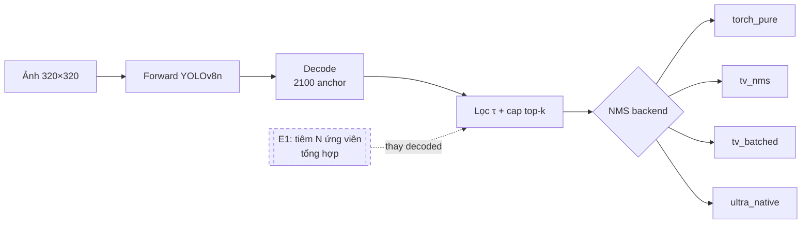

# sponge-sim: harness đo tính sẵn sàng của pipeline phát hiện vật thể dựa trên NMS

> **Câu hỏi:** Số ứng viên trước NMS (N_τ) có đủ để đánh giá một tấn công "sponge" làm cạn tài nguyên hay không?
> Khi nào việc làm phình NMS thực sự biến thành **lỗ hổng sẵn sàng** (trễ hạn chót), và khi nào thì không?

`sponge-sim/` là harness đo lường viết mới cho đề tài *Sponge Patch* (HUTECH). Nguyên tắc thiết kế: **mọi con số đều truy
được về một dòng dữ liệu thô**, mọi thí nghiệm đều được **đăng ký trước** (PREREG + `git tag`) rồi mới đo, kết quả âm
được giữ nguyên.

---

## Vì sao cần harness mới

Các lượt chạy cũ đo độ trễ mà **không ghim core**, chỉ có **1 mẫu NMS mỗi record** và chỉ dùng **một backend**. Khi phân tích
lại dữ liệu X1-500 (E2a), ta thấy một ảnh có N giống hệt nhau qua 10 lần đo, nhưng độ trễ NMS có trung vị |ln lệch| là 0,0633
và hệ số biến thiên trung vị là 1,1903. Tức là dữ liệu có đuôi dày: chênh lệch sạch–sạch có trung vị 0,27 ms nhưng p90 là 13,57 ms
(`results/e2a/20261021T145544/summary.json:historical_noise_clean`, `noise_vs_effect`).
Với mức nhiễu này, **không thể tách** phần độ trễ do patch gây ra khỏi nhiễu đo
(`posthoc_aa.json`: A/A sạch–sạch cho mean 0,0445 [−0,0151; 0,137], chồng lấn với mọi case tấn công).
Muốn trả lời được câu hỏi thì phải đo lại cho đúng.



Mỗi công đoạn (pre, forward, decode, τ, NMS, toàn trình) được **đo riêng**. Thời gian toàn trình được đo trực tiếp trong
một lần gọi, **không** cộng các trung vị lại với nhau.

## Thiết kế đo

| Thành phần | Cách làm | Kiểm chứng |
|---|---|---|
| Ghim core | `psutil.cpu_affinity` + topology đọc từ Win32 (`GetLogicalProcessorInformationEx`): P-core = logical {0,1},{2,3}; E-core = 4…11 | Tải torch với 2×\|CPU\| thread: CPU-time/wall bị chặn trên bởi số CPU được phép (`hw.verify_pin`) |
| Nhiễu đo | A/A (cùng điều kiện, hai nhãn ABBA/BAAB), 100 ảnh × 20 lần | MDE theo profile × công đoạn (E5) |
| Trôi xung nhịp | Benchmark tham chiếu đầu mỗi khối và cuối phiên | Cờ khi lệch > 3% (ghi lại, xem Hạn chế) |
| Backend NMS | 4 backend, cùng đầu vào; `prepare()` nằm ngoài vùng đo | Khớp tập giữ lại trên mẫu hữu hạn (không tuyên bố tương đương) |
| Truy vết | Code copy kèm header `file:dòng + SHA256`; manifest của mỗi run ghi git/tag, SHA code, weights, config | 37 test hồi quy |

## Kết quả đến thời điểm này

**Hồi quy (37/37 pass).** Từ raw, test tái tính đúng OLD128 SG−center p = 0,150390625 và X1-500
−0,029335…, CI95% [−0,038328; −0,021598], p = 0,001953125 (khớp tới 1e-12). Forward mới cho đúng số ứng viên đã lưu
(`tests/test_regression_x1.py`, `tests/test_regen_counts.py`).

**E5: giao thức đo** (`results/e5/20261021T151412/summary.json:profiles.<P>.stages.<stage>`)

| Profile | Forward: A/A ratio [CI95] | MDE forward | MDE toàn trình | MDE NMS torch_pure |
|---|---|---:|---:|---:|
| P1 (1 P-core) | 1,0002 [0,9963; 1,0042] | 0,58% | 0,59% | 1,07% |
| E1 (1 E-core) | 1,0081 [0,9953; 1,0220] | 1,94% | 1,27% | 2,97% |
| E4 (4 E-core) | 0,9791 [0,9310; 1,0285] | 7,45% | 6,13% | 3,47% |

Ở P-core ghim, giao thức phát hiện được chênh lệch độ trễ **dưới 1%**. E4 bị gắn cờ: trong phiên đo, 4 thread không chạy
song song thật (DEVIATIONS.md), nên không dùng E4 làm profile cho E1.

**E2a: proxy N_τ trên dữ liệu lịch sử** (thăm dò; `results/e2a/20261021T145544/summary.json`)

| Phép so | Spearman ρ [CI95, bootstrap cụm theo ảnh] |
|---|---|
| Giữa ảnh (ảnh sạch): N so với độ trễ NMS | 0,9379 [0,9215; 0,9499] |
| Trong ảnh: ΔN do patch so với Δ độ trễ (sg_ga) | 0,1214 [0,103; 0,1396] |

N xếp hạng độ trễ NMS **giữa các ảnh** rất tốt. Nhưng thay đổi N mà patch gây ra lại nhỏ (ΔN trung bình từ −2,5836 đến +1,636, `within_image.*.mean_dN`)
và chìm trong nhiễu đo lịch sử. Đây là lý do E1 tiêm tải có kiểm soát thay vì dựa vào patch.

**E1: đối chứng dương + dose-response.** PREREG đang chờ duyệt (`prereg/PREREG_E1.md`). [CHƯA CÓ SỐ: chưa đo]

## Chạy lại

```bash
cd sponge-sim
python -X utf8 -m pytest tests -q -p no:cacheprovider          # 37 test, khoảng 1 phút
PYTHONPATH=src python -X utf8 -m sponge_sim.hw                 # topology + checklist điện
python -X utf8 studies/e5_protocol/run.py --run-dir results/e5/<id>   # khoảng 40 phút, không dùng máy khi đo
python -X utf8 studies/e5_protocol/analyze.py results/e5/<id>
python -X utf8 studies/e2_proxy/e2a_historical.py              # chỉ đọc outputs/x1_500img_20261018
```

Môi trường đã dùng: Windows 11, Intel i5-1335U, Python 3.14, torch 2.13.0+cpu, torchvision 0.28.0, ultralytics 8.4.90.
Các phiên bản thực tế được ghi trong `manifest.json` của từng run.

## Cấu trúc

```
sponge-sim/
  src/sponge_sim/   hw, provenance (code copy có header nguồn), backends, inject, timing, stats, cohorts, manifest
  tests/            hồi quy so với dữ liệu đã lưu
  prereg/           PREREG_E5, PREREG_E2a, PREREG_E1 (nháp)
  studies/          e5_protocol, e2_proxy, e1_dose  (run.py + analyze.py)
  results/          raw JSONL + manifest + summary của từng run
  PROGRESS.md       Đã xong / Đang dở / Lệnh chạy tiếp / Quyết định đang chờ
  DEVIATIONS.md     mọi sai lệch so với PREREG, kèm việc đã thấy dữ liệu hay chưa
```

## Phạm vi và hạn chế (đọc trước khi trích dẫn)

- **Mô phỏng hạn chế tài nguyên trên CPU laptop ghim core.** Chỉ một laptop, một model (YOLOv8n), tensor đã chuẩn bị sẵn.
  Chưa có thiết bị ARM/edge thật, chưa print-and-camera.
- Ngưỡng cờ trôi 3% bị kích hoạt ở gần như mọi khối trong E5. Thiết kế A/A ghép cặp trong ảnh giúp triệt tiêu trôi chậm,
  nhưng phân tích độ nhạy "bỏ khối có cờ" thì không thực hiện được.
- Các backend khớp tập giữ lại trên **mẫu hữu hạn không có tie**. Đó không phải tương đương với mọi trường hợp.
- E2a là dữ liệu lịch sử, mang tính thăm dò. Phân tích A/A là post-hoc và đã khai trong DEVIATIONS.md.

## Đạo đức

Repo công bố harness đo, schema, manifest, fixture tổng hợp và dữ liệu thời gian thô. Tải dương được **tiêm tổng hợp** trên
testbed cục bộ, không cần patch tối ưu. Repo không đóng gói patch hay dịch vụ tấn công.

---
Nhóm: Phạm Tuấn Anh, Mai Quốc Bảo. GVHD và tác giả liên hệ: Đinh Phương Nam (HUTECH).
